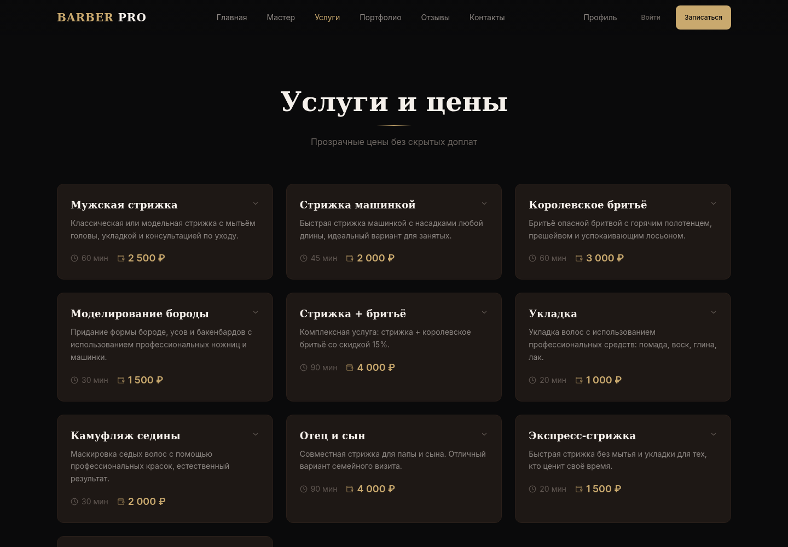

# BarberPro

SaaS-платформа онлайн-записи для барбершопа: публичный сайт, запись,
личный кабинет клиента, панель барбера и админ-панель.

## Что внутри

- Публичный сайт: услуги, цены, мастер, отзывы, контакты.
- Онлайн-запись с выбором услуги, даты и свободного слота.
- Кабинет клиента: предстоящие записи, история, профиль.
- Панель барбера: расписание, рабочие дни, блокировки, записи, клиенты.
- Админ-панель: услуги, портфолио, отзывы, настройки.
- Booking engine: генерация слотов с учётом длительности, обедов, блокировок и часового пояса.
- Уведомления: transactional outbox + BullMQ-очереди для email/Telegram/push.
- Аутентификация, RBAC, security-заголовки, rate limit, аудит.

## Стек

**Frontend:** Next.js 15 (App Router), React 19, TypeScript, Tailwind CSS v4,
Framer Motion, React Three Fiber, TanStack Query, Zustand.

**Backend:** tRPC, Prisma, PostgreSQL 16, Redis 7, BullMQ, Zod, Auth.js,
S3-совместимое хранилище, Winston.

**Качество:** Vitest, React Testing Library, Playwright, MSW, ESLint, Prettier,
Husky, GitHub Actions.

## Архитектурные документы

- [ARCHITECTURE.md](ARCHITECTURE.md) — стек, структура, слои, безопасность.
- [BOOKING_ENGINE.md](BOOKING_ENGINE.md) — алгоритм слотов, пересечения, timezone.
- [NOTIFICATION_ARCHITECTURE.md](NOTIFICATION_ARCHITECTURE.md) — outbox, очереди, retry, DLQ.
- [UX_SPECIFICATION.md](UX_SPECIFICATION.md) — карта экранов и дизайн-система.

## Live demo

https://web-khaki-beta-29.vercel.app

## Статус

Прототип с production-oriented архитектурой. Основные сценарии записи,
кабинета и панели барбера реализованы; часть интеграций (платежи, реальные
email/Telegram-провайдеры) описана в архитектуре и подключается через env.
